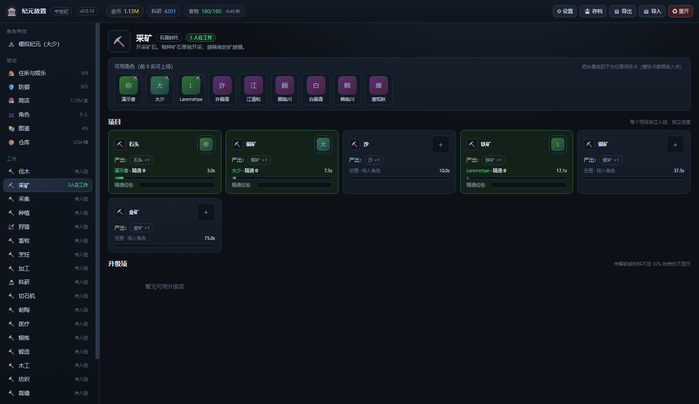
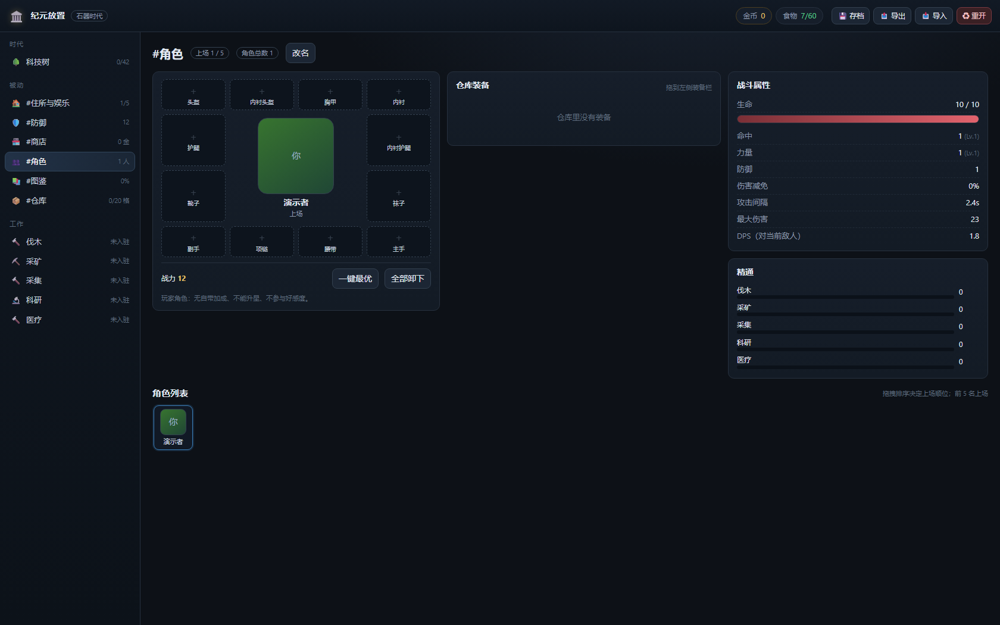
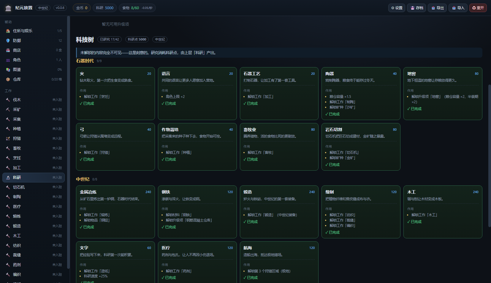

# 纪元放置 · Era Idle

> **测试版 v0.0.11** —— 0.0.x 阶段：功能可玩，数值与交互仍会随反馈调整。

从石器时代一路推到太空时代的**殖民地放置游戏**（Melvor Idle 风格的挂机 + 建设 + 抽卡 + 战斗）。

纯前端静态站点，无构建步骤，打开即玩。

## 在线游玩

**https://binbilibili.github.io/era-idle/**





## 现在能玩到什么

| 系统 | 内容 |
|---|---|
| **5 个时代** | 石器 → 中世纪 → 工业 → 信息 → 太空，42 项科技（合计 44,280 科研点），未解锁内容完全不可见；**科技树就在「科研」工作页下方** |
| **33 份工作** | 31 份常规 + 2 份角色特技（#黑暗之魂 / #模拟纪元）；**每个项目都有自己的入驻槽、图标与进度条**（采矿 = 13 种矿石各一条，时长 = 3 秒 × 100 / 权重）；左侧导航用「N人在工作」绿色小字显示在岗人数 |
| **精通** | 每个「角色 × 工作」各一份 1–100 级精通，每 10 级 +1% 速度；技能书 +10 级 |
| **升级项** | 110 档工作升级（+25/50/75/100%，27 档 +1 瓦耗电），未达 30% 材料不显示 |
| **战斗** | 8 个狩猎区域 / 18 种普通敌人 / 8 种恩赐怪；命中率、最大伤害、攻速全部按文档公式；角色不死，只会重伤 |
| **2 位英雄 + 无限随机普通角色 + 玩家角色** | **限定 / 常驻**两池（限定 10 : 1 出有名英雄，常驻 100% 全新随机角色）、30 抽保底、30% 角色 / 70% 礼物、好感 25/50/100、升星 ★1–★5；随机角色不进图鉴、可在角色页**开除**（装备退回仓库）|
| **7 套被动** | 住所（上限 5→17，硬顶 18）/ 舒适度 16 项（+0.35%/点）/ 14 项防御工事（战力 47,750）/ 商店（6 格 60 秒刷新）/ 图鉴 212 物品 / 招募 / 仓库 224 格 + 粮仓腐坏 |
| **仓库与粮仓** | 212 种物品（194 仓库 + 18 粮仓），卖出换金币，买入 3 倍价，粮仓会腐坏并产出堆肥 |
| **袭击** | 每 2 小时按「基地战力 vs 袭击强度」纯数值判定，失守抢 10% 资源 |
| **离线收益** | 离开 ≥ 60 秒回来按**期望值一次结算**（上限 8 小时）：生产 / 食物消耗 / 粮仓腐坏 / 回血 / **精通成长** / 战斗击杀 / 袭击全部补齐，并弹「🌙 离线结算」框 |
| **存档** | localStorage 自动存档 / 手动存档 / base64 导出导入 / 二次确认重开 |

## 操作

1. 左侧 **工作** → 打开某份工作 → 点项目卡右上角的 ＋ 打开下拉菜单，或把角色头像拖到**整张项目卡**上 → 角色开始周期产出。
2. **科研** 工作产出科研点 → **科技树** 逐项解锁工作、配方、建筑。
3. **仓库** 里点「卖 1 / 全卖」换金币；**商店** 用金币买材料、英雄碎片、技能书。
4. **招募** 用 10 个英雄碎片抽一次（限定 / 常驻两池）→ 送礼提升好感 → 好感 50 解锁角色特技工作；碎片还能从**图鉴首次收录**领取（物品 1 / 敌人 3 / 角色 5）。
5. **角色** 页拖装备、拖拽角色列表决定上场顺位（前 X 名上场，第 X+1 名起置灰）。
6. **狩猎** 选区域派角色自动打怪，掉落皮革/食材，涨战斗属性和图鉴认知度。

> **1 游戏日 = 24 现实秒**（1 秒 = 1 小时）；挂机时每 200ms 一跳。离开 ≥ 60 秒（关页面 / 切后台 / 电脑休眠）回来，按真实离开时间**一次结算离线收益**，上限 8 小时；不足 60 秒按 0.2 秒小步追帧。
>
> 只有「回血」按天结算：自然 5%/天 ≈ 0.21%/秒，有医疗角色 15%/天。工作、科研、精通、食物、电力、战斗、商店、粮仓腐坏、袭击仍按真实秒，数值不变。

## 目录结构

```
index.html            入口
css/style.css         全部样式（深色 Melvor 风，响应式，窄屏自然降级为单列）
js/data/items.js      212 种物品（价格 / 栏位 / 减免 / 力量 / 造价）
js/data/jobs.js       33 份工作（周期 / 配方 / 升级项 / 矿区权重 / 发电机）
js/data/techs.js      42 项科技（时代 / 前置 / 花费 / 解锁）
js/data/enemies.js    26 种敌人 + 8 区域 + 29 把武器战斗数据
js/data/passives.js   住房 / 舒适度 / 工事 / 仓库 / 粮仓档位与常数值
js/engine.js          状态机：产出、精通、战斗、抽卡、商店、袭击、存档
js/ui.js              所有页面渲染（工作页 / 角色页 / 科技 / 商店 / 图鉴 / 招募 / 被动）
js/app.js             启动、路由、拖拽、弹窗、存档按钮
design/               原始设计文档（8 份 Markdown，游戏数值的唯一权威来源）
tools/test.js         无头冒烟测试（node tools/test.js）
```

## 本地运行

```bash
# 随便一个静态服务器，或者直接双击 index.html
python -m http.server 8080
```

冒烟测试：

```bash
node tools/test.js
```

## 更新日志

### v0.0.12
- **随机普通角色改为完全无限生成**：不再预生成 6 人，每次「抽到随机普通角色」时现造一个全新角色（随机名字 / 随机属性 / 随机工作加成 / 无社交恩赐），不会重复。
- **不参与图鉴**：图鉴「角色」页只统计 2 名有名英雄，随机普通角色没有收录奖励。
- **角色页新增「开除」**：选中随机普通角色 → 红色「开除」按钮 → 二次确认 → 永久移除（存档 / 列表 / 所有岗位），**身上装备全部退回仓库**；有名英雄与玩家角色不能开除。
- 规则调整：限定池出角色时 **有名英雄合计 10 : 随机普通角色 1**（大少 / Laremehpe 各 45.5%、随机角色 9.1%）；常驻池 100% 全新随机角色；保底 30 抽后必有新角色（有名英雄没齐先补英雄，齐了给全新随机角色），**不再有「池集齐 → 星尘 ×30」**。
- 随机普通角色不能收礼物（无社交恩赐），送礼物按钮改为开除按钮。

### v0.0.11
- **离线收益上线**：读存档 `lastSave` 算现实离开时长，离开 ≥ **60 秒**才结算、上限 **8 小时**；不足 60 秒仍由正常 tick 按 0.2 秒小步追帧，不会丢时间。
- 非战斗工作按 **15 秒时间块**推进（与在线同序：食物消耗 → 生产 → 木易天二人一 → 回血），粮仓腐坏按块结算，结果与逐帧挂机一致。
- **战斗用期望值 O(1) 结算**（`design/战斗系统.md §九`）：击杀时长 = max(一次攻击间隔, 敌人 HP ÷ 玩家 DPS)，离线时长 ÷ (击杀时长 + 3 秒刷新) × 胜率 × 期望掉落。
- **战斗损耗照算**：连续作战按「挨打速率 vs 自然恢复」净掉血，撑不满离线时长就只结算撑住的那段并判**重伤**（打不过的怪同样判重伤，产出只保留打赢的部分）。
- **精通照算**：非战斗工作每 15 秒块都走 `gainMastery`，精通升级立刻反馈到下一块的速度；实测离线 1 小时伐木与在线同为 36 级（经验 1918 vs 1922，差 0.2%）。
- **袭击补算**：离线期间每 2 小时的袭击判定照常补算（最多 12 次，防旧存档连环打）。
- 启动 / 切回前台弹**「🌙 离线结算」框**：产出清单（前 10 种）、金币 / 科研 / 击杀、粮仓变化、消耗、袭击次数、重伤名单一次看全。
- 测试补 **13 条离线用例**（结算上限、腐坏、袭击次数、狩猎期望、重伤判定），并修掉战斗用例的随机重伤抖动。
- 修复**30 抽保底计数**：以前只有「抽到重复角色」才 +1，现在**礼物抽也计入**「这一抽没出新角色」—— 连续 30 抽没新角色后，第 31 抽必出。

### v0.0.10
- 「配方与入驻」改名为**「项目」**；点击入驻槽改为**下拉菜单**，不再弹全屏面板。
- 角色拖拽升级为**整张项目卡都是拖入点**，卡片会高亮显示可放下。
- 修复**精通经验条升级后不回 0**：改用「本级经验 ÷ 本级区间」，10→11 级等升级瞬间从 0 开始。
- 补齐**装备制造配方**：加工 17 件（石器 15 + 长弓 / 弩）、锻造 51 件、裁缝 17 件，全部由物品造价自动生成；加工不再缺石器装备。
- **硅片 / 光纤移出加工**：硅片改由半导体制造（2 沙），光纤改由玻璃制造（2 玻璃）。
- **卡池砍成两个**：删除神人俱乐部 / P社 / steam游戏群，改为**限定**（大少 + Laremehpe + 6 名随机普通角色）与**常驻**（纯 6 名随机普通角色）；单抽消耗 20 → **10** 碎片；限定池里有名角色的单角色权重是随机普通角色的 **10 倍**。
- **随机普通角色**：每份存档随机生成 6 人（随机名字 / 初始战斗属性 / 自带工作加成，**无社交恩赐**），两池共用。
- **图鉴首次收录奖励**：新发现的物品 / 敌人 / 角色显示**金色边框 +「领取」**，分别给 **1 / 3 / 5** 个英雄碎片，页头有**「全部领取」**；每个条目终身一次。
- 7 位旧英雄标记**退役**（数据保留、旧存档照常可用，不再进卡池与图鉴）。⚠ `[黑暗之魂]` 线随星见由岐退役暂时不可达，见 `design/角色与抽卡.md §7.3`。
- 设计文档同步：`角色与抽卡.md`（两池 / 10 碎片 / 十倍权重 / 随机普通角色 / 图鉴来源）、`被动.md`（图鉴领取 / 招募两池）、`资源表.md`（碎片折价）、`界面与交互.md`（金边与全部领取）；工作表补全 85 件装备清单与三份工作配方，资源表更新硅片 / 光纤来源。

### v0.0.8
- 角色页移除「恢复 %/天」显示；回血数值不变（自然 5%/天、有医疗 15%/天，见「时间机制」）。

### v0.0.7
- **时间基准改为 1 游戏日 = 24 现实秒**（1 秒 = 1 小时）；README 与 `design/` 同步。
- **回血改为按天结算**：自然恢复 5%/天（≈0.21%/秒），有医疗角色 15%/天。其余机制（工作、科研、精通、食物、电力、战斗、商店、粮仓腐坏、袭击）仍绑定真实秒，数值不变。

### v0.0.6
- 科技树每张科技卡新增**「作用」列表**，直接列出该科技解锁的工作 / 配方 / 升级项 / 数值加成，不再只显示一句风味描述。
- 左侧导航取消独立的「战斗」分组：**狩猎回归「工作」组**，黑暗之魂 / 模拟纪元只保留在「角色特技」组，不再重复出现。
- 被动七套的界面名称去掉 `#` 前缀（住所与娱乐 / 防御 / 商店 / 角色 / 图鉴 / 招募 / 仓库），导航与页面标题一致。
- **浅色主题补全**：导航悬停 / 徽章 / 提示框 / 日志 / Toast / 弹窗输入框 / 升级项与配方卡等不再残留深色底，滚动条、表格悬停、进度条文字也一并适配。
- 设计文档同步：科技卡「作用」列表写入界面规格，左侧导航表移除「战斗」分组，被动导航名称去掉 `#`。

### v0.0.5
- 资源条（金币 / 科研 / 食物 / 电力）从右上移到**左上、版本号右边**，右侧只留操作按钮。
- 食物额外显示**每秒消耗**（上场角色数 × 0.05）。
- 取消独立的「科研」导航组，**科研回归「工作」组、名称就叫「科研」**；科技树仍固定在其工作页下方。

### v0.0.4
- **修复浏览器缓存导致"更新没生效"**：`index.html` 里的 CSS / JS 全部加上版本查询串（`?v=0.0.4`）。之前 GitHub Pages 的 CDN 会把旧 `app.js` 缓存 10 分钟，于是出现「设置弹窗打不开、点哪都提示已切换主题、入驻槽点不动」的旧行为。
- 之后每次发版都会把查询串一起 +1，避免再被缓存。

### v0.0.3
- 修复工作页入驻槽**点击无反应**：点击处理误用了不存在的 `data-id`，改为读取 `data-job`。
- 修复**拖拽无法放入入驻槽**：`dragover` 白名单漏了 `recslot`，浏览器因此不触发 `drop`。
- 修复设置弹窗**打开后立刻关闭**：`[data-theme]` 选择器把 `<html>` 也选中了，点击冒泡到 `<html>` 时触发了"切主题 + 关弹窗"。
- 新增 `tools/browser-test.mjs`：用 Edge DevTools 协议实测点击、拖拽、主题切换、精通条更新、科研页科技树。

### v0.0.2
- 科技树并入「科研」工作页下方，左侧导航从「科技树」改为「科研 · 科技树」。
- 每条配方独立入驻槽 + 产出图标 + 独立进度条；同一角色只能占一个槽。
- 采矿改为每种矿石一条配方，按科技逐步出现；时长 = 3 秒 × 100 / 权重（权重越高越快）。
- 左侧工作列表只显示「N人在工作」（绿色），不再显示入驻者名字。
- 工作页介绍改为一句话概述，不再显示产能算式。
- 新增右上角「⚙ 设置」：深色 / 浅色主题（立即生效并写进存档）、立即存档、导出、导入。
- 修复精通经验条不随产出实时更新。

### v0.0.1
- 首个可玩测试版：33 工作 / 42 科技 / 212 物品 / 26 敌人 / 9 英雄抽卡 / 7 套被动 / 存档导出导入，上线 GitHub Pages。

## 说明

- 数值全部转录自 `design/` 下的 8 份设计文档；文档未给出、必须由实现决定的地方（如若干被动档位的建造材料、粮仓基础容量、发电设备造价）在代码注释里标了推导口径。
- 美术为纯 CSS + emoji 占位（文档提到的 `image/character/*.jpg` 素材未随文档提供）。

## License

MIT
